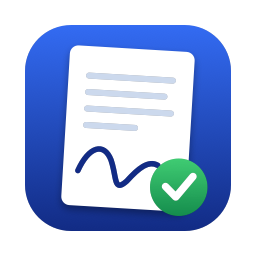

<p align="center"></p>

# Signer

**Sign PDFs with your ID card or USB token, with the stamp exactly where you want it.**

Drop a PDF on the window, drag a box where the stamp should go, and click **Sign PDF**. macOS asks
for your PIN in its own dialog, and the signed copy is saved next to the original. Adobe Acrobat
and the EU's validators accept the result.

It works with anything your Mac can sign with: the Romanian ID card (with
[RO CEI Connector](https://github.com/alxrxs/ROCEIConnector)), SafeNet tokens such as DigiSign's
qualified ones, PIV cards and YubiKeys. Insert it and it shows up.

## Using it

1. Open a PDF: drop it on the window, press ⌘O, or use **Open With → Signer** in Finder.
2. Drag a box on the page. Drag inside it to move it, or the round handle to resize it.
3. Edit the stamp text if you like; `{date}` becomes the signing time. The text fits itself to the box.
4. Click **Sign PDF…** (⌘↩) and enter your PIN.

Turn off **Visible stamp** for an invisible signature. Signing an already-signed PDF keeps the
earlier signatures valid.

Each certificate is labelled with what the signature is worth:

| Badge | Meaning |
| --- | --- |
| **QES** | Qualified: equivalent to a handwritten signature anywhere in the EU (e.g. a DigiSign token) |
| **AdES** | Advanced: valid, but not handwritten-equivalent (e.g. the Romanian ID card, valid in Romania) |

### Signature levels

By default Signer makes the strongest kind, **B-LTA**: a trusted timestamp, the certificate chain,
revocation answers and an archive timestamp, in the standard EU format (PAdES, ETSI EN 319 142-1).
It can be checked even after your certificate expires. Timestamps come from qualified EU timestamp
services: Sectigo, BOSA (Belgium), Izenpe (Basque Country) and APED (Greece), each a fallback for
the others. Nothing is embedded unchecked: each timestamp must verify and come from a service the
EU Trusted List names as qualified, and each revocation answer must verify and say your certificate
is good. A revoked certificate is refused before you're asked for the PIN. If the network fails after
you've entered your PIN, Signer keeps the signature at the highest level it reached and tells you.

| Level | Adds |
| --- | --- |
| B-B | nothing; the time comes from your Mac's clock |
| B-T | a trusted timestamp proving when you signed |
| B-LT | the certificate chain and revocation answers |
| **B-LTA** | an archive timestamp over all of it (default) |

## Requirements

- macOS 27 or later
- Swift 6.3 or later, from Xcode or the Command Line Tools (`xcode-select --install`)
- A card or token your Mac recognises (check with `security list-smartcards`)

## Install

There is no prebuilt download; both ways below build it from source on your Mac.

### Homebrew

```sh
brew tap alxrxs/tap
brew trust alxrxs/tap
brew install alxrxs/tap/signer
ln -sfn "$(brew --prefix)/opt/signer/Signer.app" /Applications/Signer.app
open /Applications/Signer.app
```

### From source

```sh
git clone https://github.com/alxrxs/signer.git
cd signer
./build.sh install
```

This builds a release copy, puts it at `/Applications/Signer.app` and launches it.
`./build.sh` on its own only builds `build/Signer.app`.

### Uninstall

Quit Signer and delete `/Applications/Signer.app` (and `brew uninstall signer` if you used Homebrew).

## Caveats

- **Preview doesn't show stamps on rotated pages.** On pages saved rotated (some scans), Acrobat and
  other viewers show the stamp but Preview doesn't. The signature itself is fine.
- **Damaged and password-protected PDFs are refused.** Open the file in Preview and use File → Export
  as PDF to get a clean copy.
- **Only cards and tokens.** Certificates stored in your login keychain aren't offered.

## Development

```sh
swift build        # debug build
swift test         # unit tests (SignerCore)
./build.sh install # build, install to /Applications and relaunch
```

`Sources/SignerCore` holds the signing logic; `Sources/Signer` is the SwiftUI app. The icon is drawn
by `scripts/make-icon.swift`.

macOS has no way to sign a PDF: PDFKit rewrites the whole file when saving, which would break
existing signatures. So Signer adds the signature as an incremental update after the original bytes,
which it never changes, and leaves all rendering to PDFKit. Before saving, it reads the result back
and verifies every signature in it.

Releases are tagged `vX.Y.Z`; `build.sh` stamps the latest tag into the app's version.

## License

[AGPL-3.0](LICENSE). Copyright © 2026 Andrei.
